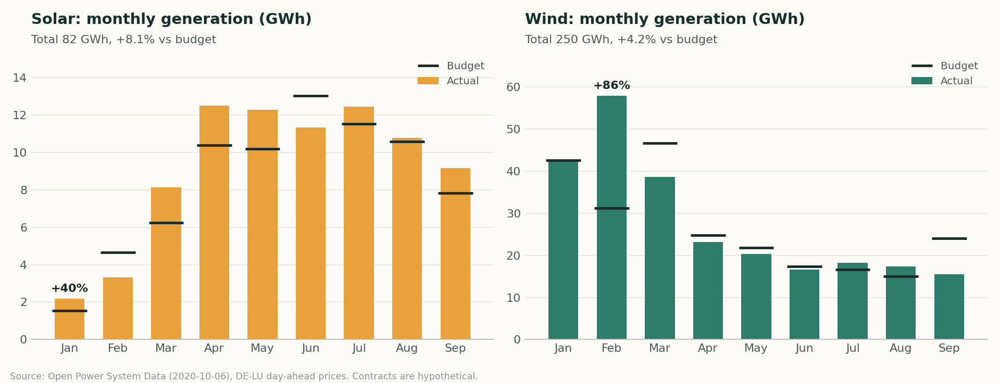
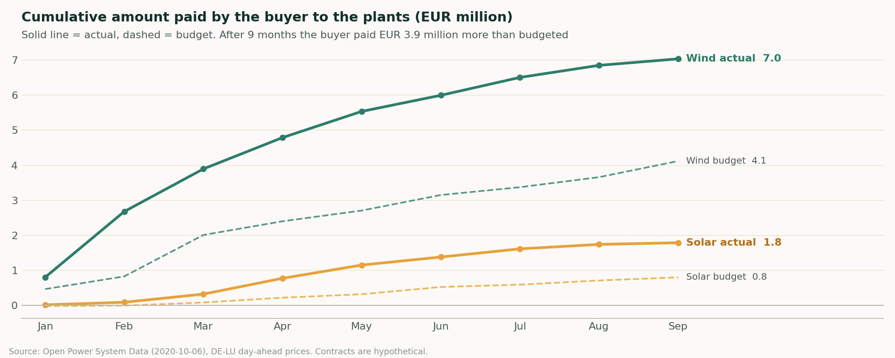
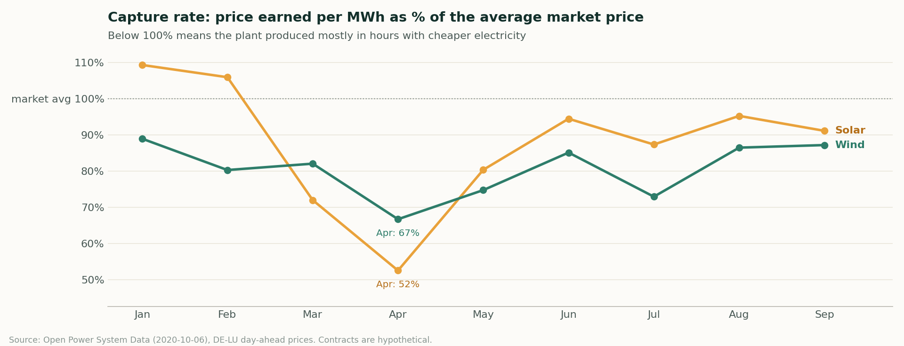

# PPA Settlement Analysis: Solar and Wind in Germany

How much does a company really pay for the renewable energy it buys through virtual PPAs, and why does the bill end up different from the budget?

I built this project to answer that question with real market data. It models a company that signed two virtual PPAs in Germany, one with a 100 MW solar plant and one with a 150 MW onshore wind farm, and settles both contracts hour by hour against the German day-ahead price for January to September 2020.

My background is in energy storage engineering, where I sized battery systems and checked my calculations against field tests. Here I wanted to apply the same habit to the commercial side of renewable energy: build a forecast, compare it with what actually happened, and explain the gap.

## What the analysis does

- Calculates hourly generation for each plant and the monthly settlement of each contract
- Builds a monthly budget for 2020 using only 2019 data, the way a budget would be built in practice
- Splits the difference between budget and actual into a volume effect (the plant produced more or less) and a price effect (the market paid more or less)
- Checks the counterparty invoices against my own settlement calculation and flags any line that differs by more than 1%
- Reports net cost per MWh, capture rate and exposure to negative price hours

## Data and assumptions

| Item | Source or assumption |
| --- | --- |
| Hourly day-ahead price, DE-LU bidding zone | [Open Power System Data](https://data.open-power-system-data.org/time_series/2020-10-06/), time series package of 2020-10-06 |
| Hourly solar and onshore wind capacity factors for Germany | Same source: national generation divided by installed capacity (the latest capacity value is carried forward when 2020 is missing) |
| Plants and contract prices | Hypothetical: 100 MW solar at 45 EUR/MWh and 150 MW wind at 50 EUR/MWh |
| Generation of each plant | German national capacity factor scaled to the plant's capacity |
| Counterparty invoices | Simulated from my results with two errors added on purpose, to test the reconciliation |

A virtual PPA does not deliver physical energy. Every hour, the buyer and the plant settle the difference between the market price and the agreed price: settlement = (market price minus contract price) x generation. When the market pays less than the contract price, the buyer pays the difference to the plant. The buyer keeps the renewable energy certificates.

## Results (January to September 2020)

| Contract | Generation (GWh) | vs budget | Settlement (EUR M) | Budget (EUR M) | Volume effect (EUR M) | Price effect (EUR M) |
| --- | --- | --- | --- | --- | --- | --- |
| Solar, 100 MW | 82.1 | +8.1% | -1.79 | -0.80 | -0.06 | -0.93 |
| Wind, 150 MW | 250.3 | +4.2% | -7.04 | -4.12 | +0.06 | -2.98 |

Negative settlement means the buyer paid the plant.

**The price, not the plants, explains the overrun.** The two contracts cost EUR 8.8 million in nine months against a budget of EUR 4.9 million. The price effect accounts for EUR 3.9 million of the gap, while the volume effect stayed below EUR 0.1 million per contract. In 2020 demand fell during the COVID-19 lockdowns, and day-ahead prices dropped well below 2019 levels. A budget built only on the previous year could not anticipate that, which is the strongest reason to add price scenarios to the forecast.

**Solar lost more value to timing.** In April solar captured only 52% of the average market price, because its output was concentrated in the midday hours when prices were lowest. Wind stayed between 67% and 89% during the whole period. Over the nine months the buyer paid about EUR 22/MWh above market for solar energy and EUR 28/MWh for wind.

**The invoice check found both errors.** The reconciliation flagged the two problems planted in the simulated invoices: a 3% volume overstatement in the March wind invoice (EUR 36,522) and a wrong contract price in the June solar invoice (EUR 22,645).

**Limitation.** OPSD does not report German solar capacity for 2020, so the end of 2019 value is used for the whole year. Germany kept adding solar panels in 2020, so solar generation is probably overstated by a few percent, and part of the +8.1% against budget may come from this.





## How to run it

The easiest way is Google Colab: open `run_in_colab.ipynb` and choose Runtime > Run all.

To run it on your computer:

```bash
pip install -r requirements.txt
python src/download_data.py        # downloads about 120 MB and keeps only the German columns
python src/portfolio_analytics.py  # tables, charts and summary
python src/run_sql.py              # SQL reports
```

`python src/portfolio_analytics.py --demo` runs everything with made up data, only to check that the code works.

## Files

| Path | Content |
| --- | --- |
| `src/download_data.py` | Downloads the data and keeps the columns used |
| `src/portfolio_analytics.py` | Generation, budget, settlement, variance, invoice check and charts |
| `src/run_sql.py` | Runs the SQL file against the DuckDB database |
| `sql/reporting_queries.sql` | Totals, months that missed budget, variance bridge, negative prices, invoices to review |
| `outputs/` | Result tables, summary and charts |
| `run_in_colab.ipynb` | Runs the whole project in Google Colab |

## Tools

Python (pandas, NumPy, Matplotlib), SQL with DuckDB, Google Colab. I used Claude as a coding assistant to write and debug the code faster, and I checked the logic and the results myself.

## What I would add next

Metered data from a real plant instead of national profiles, tracking of renewable energy certificates against a consumption target, and a P50/P90 range for the generation forecast.

## Author

Melissa Aristizabal, Energy Engineer. [LinkedIn](https://www.linkedin.com/in/melissa-aristizabal)
